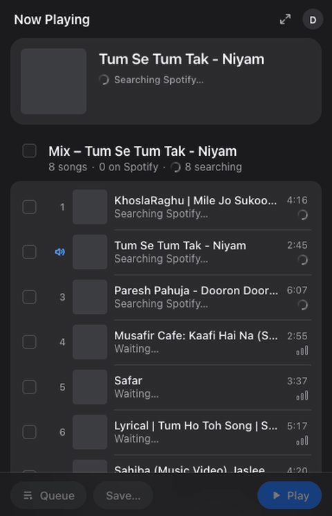

# Dhaara: YouTube Mix to Spotify extension for Chrome and Brave

Dhaara is a free, open-source browser extension that moves the YouTube Mix, playlist or song you're watching to Spotify, so you can play, queue or save it there.

**Website:** <https://kushagramehta.github.io/Dhaara/> · **Source:** <https://github.com/KushagraMehta/Dhaara> · [llms.txt](llms.txt)

*Let your YouTube Mixes flow into Spotify.* Dhaara (Hindi for "stream, flow") is a Chrome and Brave extension. It finds the song, YouTube **Mix** or playlist you are watching on Spotify. Play it there, queue it, add it to Liked Songs, or save the whole Mix to a playlist that keeps growing with it.

Not affiliated with YouTube or Spotify. YouTube and Spotify are trademarks of their owners.

## Table of contents

- [Features](#features)
- [What it reads](#what-it-reads)
- [Why Dhaara](#why-dhaara) (comparison with TuneMyMusic, Soundiiz and others)
- [FAQ](#faq)
- [Install](#install)
- [Connect to Spotify](#connect-to-spotify)
- [Use](#use) · [Keyboard shortcuts](#keyboard-shortcuts) · [Linked playlists](#linked-playlists) · [Full view](#full-view)
- [Permissions, and why](#permissions-and-why) · [Privacy](#privacy)
- [Files](#files) · [Known limits](#known-limits) · [Contributing](#contributing) · [License](#license)

## Features

### Works on everything you watch

- Any YouTube video: uses YouTube's own "Music in this video" credit when the video has one.
- YouTube Mixes, including your personal auto-generated ones (`list=RD…`). **Load More Songs** adds about 24 more each time, without playing them.
- Playlists (on a watch page and on the `/playlist` page; **Load Entire Playlist** scrolls long ones), Shorts (the song the Short uses), and YouTube Music queues, playlists and albums.

<!-- Screenshot: remove these comment marks once docs/site/assets/screenshot-popup-mix.png exists (see docs/site/assets/screenshots.md)

-->

### Smart matching (built for Hindi, Punjabi and Bollywood titles)

- Cleans messy titles. Reads Devanagari and Gurmukhi script, Hinglish spellings (ee/i, oo/u, w/v) and film names, and runs up to 3 Spotify searches per video.
- Prefers the same version (slowed, lofi, remix) when Spotify has it. Otherwise it offers the original, marked "check".
- Shows how sure each match is: **Sure**, **Check**, **Unsure** or **Not found**. Only sure matches start ticked, so nothing doubtful is added silently. **Review N** walks you through the rest.
- Fix a match once and it stays fixed in every Mix. Songs not on Spotify are searched again after a week.
- Tested offline on 167 real YouTube titles in [`tests/`](tests/) (the Spotify results there are simulated, with look-alike decoys): every song scored Sure was the right one, and no decoy was ever marked Sure. 4 of the 139 right songs only reached Check. A second set of 57 titles, built blind on its first run, scores 54 of 54.

<!-- Screenshot: remove these comment marks once docs/site/assets/screenshot-matching.png exists

-->

### Play, queue, like, save

- **Play** (on the song card: plays from that song on), **Queue**, **Add to Liked Songs** (the heart shows your real Liked state), and **Save to a new or existing playlist** (songs already in it are skipped).
- **Linked playlist per Mix:** saving the same Mix again adds only the new songs. Dhaara never removes a song.
- Choose which Spotify device plays (it remembers). **Open in Spotify** opens the desktop app when you have it, otherwise the web player, and you can set your preference.

<!-- Screenshot: remove these comment marks once docs/site/assets/screenshot-save-linked.png exists

-->

### One player at a time

- Starting Spotify from Dhaara pauses the YouTube video, and starting YouTube pauses Spotify. The popup mirrors Spotify's play and pause state while it is open. You can turn this off in Settings.

### Keyboard shortcuts

- Alt+Shift+L likes, Alt+Shift+Q queues, Alt+Shift+S saves the Mix (Option+Shift on a Mac). The toolbar icon shows ✓, ? or ! to say how it went. You can make them global.

### Full view for big lists

- Combine several Mixes, add any song by hand, copy Spotify links (paste them into a playlist in the Spotify desktop app), select all, and find matches again.

### Easy, private setup

- One click: Dhaara fills in Spotify's developer form for you, or reuses your existing Spotify app. The login is Spotify's official PKCE flow, with no server and no secret.
- An optional unofficial no-setup mode exists (see [Connect to Spotify](#connect-to-spotify)). If it fails, you are told why and offered the official setup.
- Everything stays in your browser. There is no analytics, and **Disconnect** deletes what Dhaara saved.

### Polished and accessible

- Apple-style design in light and dark, keyboard friendly, with screen-reader labels, and support for reduced motion and increased contrast.

## What it reads

| Page | What you get |
|---|---|
| Any YouTube video | That song (uses YouTube's own "Music" credit when the video has one) |
| A Mix (`list=RD…`) | The song playing, plus the Mix as a tracklist. **Load More Songs** fetches about 24 more each time, without playing them |
| A playlist | On a watch page, the songs in its side panel. On the `/playlist` page, every song: **Load Entire Playlist** scrolls long ones |
| Shorts | The song the Short uses, when YouTube shows it |
| YouTube Music | The Up next queue, playlists and album pages (clean titles, so the best matches) |

Dhaara reads the page you have open. It does not log in to YouTube and does not touch your YouTube account.

## Why Dhaara

- **It reads personal Mixes.** Your Mixes are made on the fly for you, so there is no link a web importer can follow. Dhaara reads the page you are watching.
- **It is built for messy titles,** including Hindi, Punjabi and Bollywood film songs and Devanagari script.
- **It plays, not just imports.** Play, queue, like or save from the video you are on, with keyboard shortcuts.
- **It is open source with no server.** Everything stays in your browser.

### How Dhaara compares

Last checked on 3 Nov 2026 from each tool's own site and store listing and from press reports. We did not test the other tools ourselves. "Unknown" means we could not verify it. If something is wrong, [open an issue](https://github.com/KushagraMehta/Dhaara/issues) and we will fix the table.

| Tool | Personal Mixes (`list=RD…`) | Free | Open source | No server | Hindi / Punjabi matching | Play or queue directly |
|---|---|---|---|---|---|---|
| **Dhaara** (this extension) | Yes | Yes | Yes (MIT) | Yes | Yes, built for it | Yes (Spotify Premium needed) |
| TuneMyMusic (web) | Not reliably ¹ | Free tier, paid plans ² | No | No | Unknown | No |
| Soundiiz (web) | Unknown ¹ | Free tier, paid plans ² | No | No | Unknown | No |
| Spotify's "Import your music" ³ | Not reliably ¹ | Yes | No | No | Unknown | No, it makes playlists |
| Youfy (Chrome extension) ⁴ | Unknown | Free to install, paid features reported | Unknown | Unknown | Unknown | Not listed |
| Spotlistr (web) ⁵ | Unknown | Yes | Unknown ⁵ | No, a web app | Unknown | No |

1. Your personal Mixes are generated for you, and YouTube's playlist API does not return them, so importers that read playlists through that API usually can't import a Mix. We have not re-tested each importer on each release. Soundiiz may work differently.
2. The free tiers have limits on tracks or features. Check each site for the current limits.
3. Spotify's built-in importer (announced Nov 2025) opens TuneMyMusic inside the Spotify app, according to press reports.
4. Its Chrome Web Store listing says it caps a playlist at 50 videos, and a third-party directory shows a last update in May 2023. Check that it still works before you install it.
5. The original Spotlistr repository (Apache-2.0) is archived and says the site was rewritten. We could not confirm whether the current site is open source.

Where the others are better: TuneMyMusic and Soundiiz cover dozens of services and need no install. Dhaara only does YouTube to Spotify, and it needs a Spotify developer app (see [Connect to Spotify](#connect-to-spotify)).

### Why an extension

- Your personal Mixes are made on the fly for you. The YouTube Data API does not return them, so link-based importers (TuneMyMusic, and Spotify's own **Import your music**, which uses it) can't read them reliably.
- Video titles are messy ("Chann | Udta Teer | Ayushmann Khurrana… | Sachin-Jigar, Arijit Singh"). The matcher:
  - cleans each title and runs up to 3 Spotify searches per video
  - turns Hindi and Punjabi script into English letters, and uses the film name as a clue
  - scores the results on song name, artist and duration
  - never ticks a same-name song by a different artist automatically (another "Safar")
- No server and no secret.

## FAQ

### How do I convert a YouTube Mix to a Spotify playlist?

Install Dhaara, open the Mix on YouTube, click the Dhaara icon, then choose **Save** to put the ticked songs in a new Spotify playlist. Dhaara matches each video to a Spotify song first, and a Mix saved this way stays linked to its playlist, so saving it again adds only the new songs. It works for personal Mixes (`list=RD…`) because it reads the page you have open instead of a link.

### Why can't TuneMyMusic, Soundiiz or Spotify's "Import your music" import my YouTube Mix?

Link-based importers read playlists through YouTube's API, which does not return a personal Mix: YouTube builds it on the fly for you, so there is no fixed playlist for a link to point at. Dhaara reads the Mix from the page you are watching, so it sees the songs YouTube shows you at that moment. We have not re-tested every importer on every release, so treat this as the usual result, not a guarantee.

### Is there a free Chrome extension that moves YouTube songs and playlists to Spotify?

Yes. Dhaara is free, MIT-licensed and works in Chrome and Brave. It has no paid tier and no account of its own, but you do need a Spotify developer app, and Spotify requires that app's owner to have Premium.

### Do I need Spotify Premium or my own Spotify app to use Dhaara?

For the official setup, yes to both: Dhaara logs in through a Spotify developer app that you own (it fills in Spotify's Create app form for you in about a minute), and Spotify requires the app's owner to have Premium, a rule for these apps since Feb 2026. Playing and queueing also need Premium, and one app can serve at most 5 people. An optional unofficial no-setup mode exists, but it can break whenever Spotify changes its web player.

### Does Dhaara work with Hindi, Punjabi and Bollywood song titles?

Yes, the matcher was tuned for them: it turns Devanagari and Gurmukhi script into English letters, handles Hinglish spellings and uses the film name as a clue. In the offline test set of 167 real titles, every song scored Sure was the right one, and doubtful matches start unticked so you can check them. Songs that are not on Spotify show "Not found on Spotify".

### Does it work with YouTube Music?

Yes. On music.youtube.com Dhaara reads the Up next queue, playlists and album pages, and the clean titles there give the best matches. It does not log in to YouTube and does not touch your YouTube account.

### Is Dhaara safe and private?

Everything stays in your browser: there is no server, no account of its own and no analytics, and requests go only to YouTube and Spotify. Dhaara never reads your Spotify password, and **Disconnect** deletes the login, saved matches, your list and the playlist links. The full text is in [PRIVACY.md](PRIVACY.md).

### How do I play or queue a YouTube song on Spotify?

Click the Dhaara icon on the video, then **Play** or **Queue** on the song card. Play moves Spotify to your chosen device and says "Playing" only after Spotify confirms the song started. Spotify must be open somewhere (the desktop app or open.spotify.com), and playing needs Premium.

### Does Dhaara keep my Spotify playlist up to date as my YouTube Mix changes?

A Mix saved to a new playlist is linked to it. Next time you open that Mix, Dhaara shows how many songs are new and adds only those when you save again (or press Alt+Shift+S). It never removes a song, never adds back one you took out by hand, and does not sync in the background.

### Is Dhaara an official YouTube or Spotify product?

No. Dhaara is an independent open-source project, not affiliated with, endorsed by or sponsored by YouTube, Google or Spotify. It uses Spotify's documented Web API through your own Spotify app, and it reads YouTube pages that you have open.

## Install

Dhaara is not on the Chrome Web Store yet. Install it from this repository:

1. Open `brave://extensions` (or `chrome://extensions`) and turn on **Developer mode**.
2. Click **Load unpacked** and pick this folder.
3. Click the Dhaara icon, then choose how to connect to Spotify (next section).

## Connect to Spotify

You choose once, on first run. Each way keeps its own login, so you can switch later in Settings.

### Official setup (recommended)

Takes about a minute. Dhaara logs in with Spotify's documented PKCE flow, through a Spotify app that you own.

1. Click **Set Up Spotify…**. Spotify's developer dashboard opens, with a note at its bottom right that tells you each step.
2. **No app yet:** click **Create app**. Dhaara fills in the form (name, redirect URI and **Web API**). Tick Spotify's terms box and click **Save**. Dhaara then opens the new app's settings, checks that the redirect URI is listed, and opens the Spotify login.
3. **You already have an app** (Spotify allows one per developer account since Feb 2026): click **Use my existing app**. Dhaara opens its settings and adds the redirect URI there (filled in and outlined: you click **Save**), then asks you to confirm.
4. Approve the Spotify login, and you are done.

Dhaara only takes the Client ID of an app that this setup created, or of an app you confirmed. Opening some other app in the dashboard does nothing.

Spotify's rules for these "Development mode" apps since Feb 2026:
- **The app owner needs Spotify Premium.**
- At most 5 people (added under User Management) can use one app.
- Playing and queueing also need Premium.
- A login lasts 6 months; after that you click **Connect Spotify…** again.

The redirect URI is shown in Settings (under **Set It Up by Hand**) and is added automatically by the setup. If the page filling ever fails, use that section to paste your Client ID yourself.

### No setup (unofficial)

Click **Use My Spotify Tab** instead. Dhaara uses the Spotify web player you are already logged in to.

- **How it works:** it opens (or reuses) an `open.spotify.com` tab and borrows the session the player itself uses. The scripts that do this are added to `open.spotify.com` only while this login is on (not in the manifest): choosing the official setup, or **Disconnect**, removes them. A Spotify tab that was open before you switched is given them at once and reloaded only if it stays silent. Search, playlists, Liked Songs and playback commands are then sent from that tab to the private web-player API that the Spotify site calls. Your password and cookies are never read, and the session never leaves the tab.
- **It is unofficial.** This is Spotify's private web-player API, and Spotify's terms do not allow using it this way. The risk falls on your account.
- **It can break.** Spotify changes the web player often and without notice. Dhaara re-reads the request hashes from the player and retries, but sooner or later an update will stop it. When that happens you are told why, and offered the official setup.
- **It needs an open Spotify tab.** Keep an `open.spotify.com` tab open (it can sit in the background) and stay logged in. If you close it, Dhaara opens a new one when it needs it. Playing and queueing still need Premium.
- **The heart may lag.** Reading your real Liked Songs depends on a private operation that the player may not offer; if so, the heart shows only what you liked in this session.

The ideas and code it borrows are credited in `THIRD_PARTY_NOTICES.md`.

## Use

- **Popup:** open a video, Mix or playlist and click the icon. The top card is the song playing now: **Play**, **Queue**, ♡ (Liked Songs), **+** (save to a playlist) and a swap button (wrong song? pick another).
- **The tracklist:** the bars show how sure the match is.
  - 3 bars: sure (ticked for you)
  - 2 bars: check it
  - 1 bar: unsure
  - empty: not on Spotify

  Doubtful matches start unticked. **Review N** walks you through them. Click a row to pick a different song; a song you fix once stays fixed in every Mix. The bottom bar plays, queues or saves the ticked songs.
- Matching, queueing and saving run in the background, so you can close the popup.
- Play and queue need Spotify open somewhere: the desktop app, or a tab at open.spotify.com. With more than one device available and none playing, Dhaara asks which one to use and remembers your answer.
- **Play** moves Spotify to that device first and checks that the song really started. It says "Playing…" only when Spotify confirmed it; otherwise it tells you what to do (open the Spotify app and press play once). Spotify takes up to 100 songs per play.
- **One player at a time:** when you play from Dhaara, YouTube is paused first; when a YouTube video starts, a playing Spotify is paused (the status line says so). Spotify's terms do not allow its audio next to video. Turn it off in Settings: **When One Starts, Pause the Other**. Dhaara reads Spotify's playback only while the popup is open (every 3 seconds, to show **Pause** / **Resume** and what is playing) and once when a video starts.
- **Open in Spotify** (art, titles, links): in the app when Spotify's device list showed the desktop app in the last 14 days, otherwise in the web player. A browser cannot tell whether an app is installed, so Settings has **Open Songs In**: Automatic, Spotify App or Web Player. The first time, your browser asks to open Spotify. Tick Always Allow.

## Keyboard shortcuts

Work from the YouTube tab you are looking at, without opening the popup.

| Shortcut | Does |
|---|---|
| Alt+Shift+L | Likes the song playing on YouTube |
| Alt+Shift+Q | Queues the song playing on YouTube |
| Alt+Shift+S | Saves the Mix on the page to its linked playlist: only the songs that start ticked (sure matches and hand picks) |

A shortcut acts only on a sure match. The toolbar icon's badge tells you how it went: **✓** done, **?** not sure, so nothing was done (open the popup to look), **!** an error (the popup shows it).

Settings in the full view lists the shortcuts as your browser has them now. To change one, paste `brave://extensions/shortcuts` (or `chrome://extensions/shortcuts`) into the address bar: browsers do not let an extension open that page for you. There you can also make a shortcut **global**, so it works while another app is in front.

## Linked playlists

A Mix saved to a new playlist is **linked** to it. Next time you open that Mix:

- a line under its title says "Linked to <playlist>, 3 new songs since you last saved";
- the Save sheet picks that playlist for you, is titled "Add New Songs to <playlist>", and its button says "Add 3 New Songs".

Saving only ever **adds**. YouTube refills a Mix as you listen, so Dhaara never removes a song from your playlist, and a song you took out by hand is not added back. Single songs go to Liked Songs or a playlist you choose, with no link. Alt+Shift+S uses the same link (and makes a new private playlist the first time).

## Full view

The open icon at the top right of the popup opens a full page with the same look. There you can:

- combine several Mixes into one list, add any song by hand, and copy Spotify links (paste them into a playlist in the Spotify desktop app with Ctrl/Cmd+V);
- save to a playlist or play and queue the ticked songs;
- open **Settings** from the account button: switch the way you connect, change the Client ID, see the keyboard shortcuts, and **Disconnect**.

**Disconnect** asks first, then deletes everything Dhaara saved about your account: the login, every saved match and hand pick, your list, the playlist links, the remembered device and the ticks. It keeps your Client ID and the way you connect.

## Permissions, and why

| Permission | Used for |
|---|---|
| `youtube.com`, `music.youtube.com` | Reading the song list from the page you are on |
| `accounts.spotify.com`, `api.spotify.com` | Logging in and the Spotify Web API |
| `developer.spotify.com` | **Only during setup:** filling in the Create app form or the app's redirect URI, after you click Set Up Spotify. The script is added when setup starts, stops itself when setup is over, and is removed after 30 minutes at the latest (when the page asks, or at browser start) |
| `open.spotify.com`, `open.spotifycdn.com` | **No-setup login only:** talking to your Spotify tab, and reading the player's script files (to find its request hashes). The background fetches that page and those files without cookies |
| `*.chromiumapp.org` | The login's return address, which is on your extension's own ID (`<id>.chromiumapp.org`): the Brave fallback tab watches for it |
| `identity` | The Spotify login window |
| `storage` | Your Client ID, login, match cache, hand picks, playlist links and chosen device, all kept in your browser |
| `scripting`, `activeTab` | Reading a YouTube tab that was open before the extension was installed; adding the setup script during setup; adding the no-setup login's page scripts while that login is on |

Keyboard shortcuts need no permission. Nothing is loaded from Google Fonts or any other site: the extension uses your system font.

## Privacy

Everything stays in your browser. Requests go only to YouTube and Spotify. There is no analytics and no server of ours. **Disconnect** deletes what was saved. Full text: `PRIVACY.md`.

## Files

| File | What it does |
|---|---|
| `manifest.json` | Name, permissions, keyboard shortcuts. Its `key` pins the extension ID |
| `content.js` | Reads songs from YouTube / YouTube Music pages, and fetches more Mix songs |
| `popup.html`, `popup.js` | The toolbar popup |
| `import.html`, `import.js` | The full view and its Settings |
| `background.js` | Matching, play/queue/save/like jobs, keyboard shortcuts, linked playlists, setup handoff, Disconnect |
| `spotify.js` | Official login (PKCE) and the Spotify Web API (Feb 2026 endpoints) |
| `spotify-web.js`, `spotify-hook.js`, `spotify-bridge.js` | The no-setup login: the same functions through your Spotify tab. The two page scripts are registered by `background.js` only while that login is on |
| `spotify-setup.js` | Fills in Spotify's Create app form or an existing app's redirect URI, and picks up the Client ID of the right app (only present during setup) |
| `match.js` | Title cleaning, search queries, match scoring (pure JS, runs under node) |
| `store.js`, `ui.js` | Shared storage layout, links, and DOM helpers (pop-up menu, device sheet, confirmations) |
| `styles.css` | The design system (tokens, components, motion) |
| `icons/` | Toolbar and store icons |
| `tests/` | Golden set of real YouTube titles for `match.js` (`node tests/run.mjs`) |
| `DESIGN.md`, `docs/` | Design notes, decisions and the feature list |
| `docs/site/` | The landing page, published to GitHub Pages by `.github/workflows/pages.yml` (only this folder is published) |
| `docs/launch/` | Drafts for the repository settings, the Chrome Web Store listing, launch posts and directories (not part of the extension) |
| `llms.txt` | A plain summary of the project for AI answer engines (a copy is in `docs/site/`) |
| `CONTRIBUTING.md` | How to load it unpacked, run the tests and report a bad match |
| `LICENSE`, `THIRD_PARTY_NOTICES.md` | MIT licence, and credits for the MIT code the no-setup login borrows from |
| `PRIVACY.md` | What is stored, what is sent, and how to delete it |

## Known limits

- If YouTube changes its page layout, `content.js` selectors may need updating. They were checked against live pages on 3 Nov 2026.
- **Load More Songs** uses YouTube's own internal request, the same one the page makes. It is read-only, but YouTube can change or block it at any time.
- Spotify search returns at most 10 results per query for development-mode apps, and some songs on YouTube are not on Spotify. A song not found is searched again after a week.
- A Mix is only what YouTube shows for you at that moment; it keeps changing, which is why saving only adds.
- Shortcuts only act on sure matches, and a shortcut key can clash with another extension or app. Change it on the browser's shortcuts page.
- If Brave's login window fails, the login falls back to a normal tab.
- **A Chrome Web Store install gets a different extension ID** from the one this folder pins, so its redirect URI is different too. Official setup fills in the right one automatically; if you set it up by hand, copy the redirect URI from Settings.

## Contributing

Bug reports, bad matches and pull requests are welcome. See [CONTRIBUTING.md](CONTRIBUTING.md): how to load the extension unpacked, run `node tests/run.mjs` and `node tests/folds.mjs`, and report a wrong match (send the YouTube title and the right Spotify link).

## License

[MIT](LICENSE). Credits for the borrowed MIT code are in [THIRD_PARTY_NOTICES.md](THIRD_PARTY_NOTICES.md).
